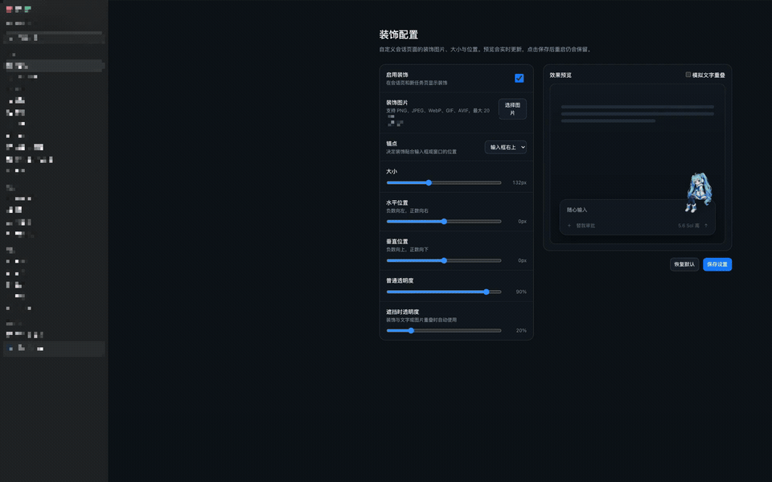
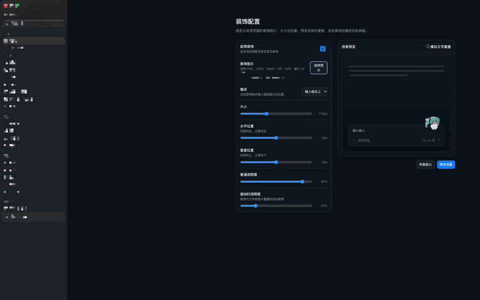
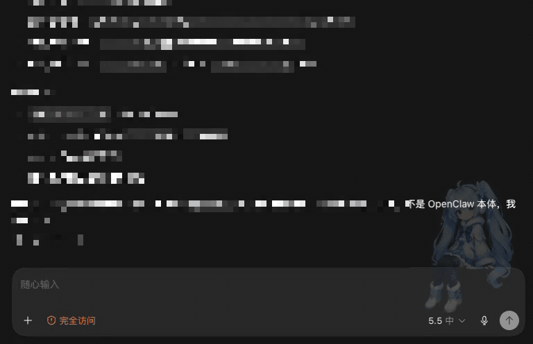

# ChatGPT Decoration Project

这是配置驱动的完整可构建源码，不修改官方 ChatGPT.app、应用签名或官方更新器。

## 主要能力

- 在 ChatGPT/Codex 会话页和新任务页内嵌装饰，不使用独立叠加层应用。
- 设置导航底部提供“装饰配置”，可选图、调整锚点、大小、位置和透明度。
- 预览与实际页面共用同一定位公式，并参考最近一次实际输入框宽度。
- 支持 PNG、JPEG、WebP、GIF 和 AVIF；GIF 使用正在播放的预加载节点原子替换，保留动画时间线。
- 默认装饰图片 `work/snow-miku-runtime-patch/assets/snow-miku.png` 由 OpenAI ImageGen 生成。
- 装饰与文字或图片重叠时自动降低透明度，不阻塞鼠标和输入交互。
- 更换图片时预加载并原子切换，同时避免新旧图片交替闪烁。
- 注入器单实例运行；意外退出时由用户级接管器在原调试端口恢复。
- 官方 App 更新重启后自动回到装饰版启动流程。

## 安装与使用

> [前往 Releases 下载最新安装包](https://github.com/Yzhaoqi/ChatGPT-Decoration-Project/releases/latest)

### 准备条件

- macOS 12 或更高版本。
- 已安装并能够正常登录的官方 `ChatGPT.app` 或 `Codex.app`。
- 装饰版不会修改、替换或重新签名官方 App；装饰图片只在本机读取，不会上传。

### 1. 安装装饰版

1. 打开项目的 [Releases 页面](https://github.com/Yzhaoqi/ChatGPT-Decoration-Project/releases/latest)。
2. 在最新版本的 **Assets** 中下载 `ChatGPT-Decorations-App-v*.zip`。不要下载 GitHub 自动生成的 “Source code” 压缩包，它只包含源码，不含可直接运行的 App。
3. 在 Finder 中双击 ZIP 解压。
4. 按 `Cmd+Q` 完全退出正在运行的官方 ChatGPT/Codex，而不是只关闭窗口。
5. 打开解压目录中的 `ChatGPT 装饰版.app`。如果 macOS 阻止首次打开，请在 Finder 中右键 App，选择“打开”，再确认一次。
6. 首次成功启动后，程序会在 `~/Applications/ChatGPT 装饰版.app` 安装稳定副本。建议将这个副本放入 Dock，今后从这里启动。

首次启动还会创建以下用户配置目录，后续更新装饰版不会覆盖其中的配置和图片：

```text
~/Library/Application Support/ChatGPTDecorations/
```

### 2. 设置自己的装饰

1. 在装饰版 ChatGPT/Codex 中打开“设置”。
2. 在设置侧栏底部选择“装饰配置”。
3. 点击“选择图片”，选择本地 PNG、JPEG、WebP、GIF 或 AVIF 图片。
4. 调整锚点、大小、水平/垂直位置、普通透明度及遮挡时透明度，右侧会实时预览。
5. 点击“保存设置”。装饰会立即应用到会话页和新任务页，并在下次启动时继续保留。

如果需要直接修改 JSON，可以打开发布包中的 `编辑装饰配置.app`。它会打开配置目录以及 `decorations.json`；保存后按 `Cmd+Q` 完全退出客户端，再重新打开装饰版即可载入。

### 3. 日常启动与恢复原版

- 日常使用时从 `~/Applications/ChatGPT 装饰版.app` 或 Dock 启动。官方客户端更新后，用户级接管器会自动回到装饰版启动流程。
- 如需暂时停用装饰，双击发布包中的 `恢复原版 ChatGPT.app`。它会停止注入器并正常启动官方 App，不会删除账号、会话或装饰配置。
- 以后再次打开 `ChatGPT 装饰版.app`，即可重新启用装饰。

### 常见问题

- **没有看到装饰或“装饰配置”入口**：按 `Cmd+Q` 完全退出所有 ChatGPT/Codex 进程，再从装饰版 App 启动。
- **macOS 提示无法验证开发者**：在 Finder 中右键 `ChatGPT 装饰版.app`，选择“打开”，不要直接双击。
- **更换图片后仍显示旧图**：先点击“保存设置”；如仍未刷新，完全退出后重新打开装饰版。

## 效果演示

### 切换静态与动态装饰

[](docs/media/decoration-image-switch.mp4)

选择本地 PNG、JPEG、WebP、GIF 或 AVIF 图片后，预览区会立即更新；动态图片切换时保留动画时间线。点击动图可查看高清 MP4。

### 调整位置与透明度

[](docs/media/decoration-position-opacity.mp4)

大小、水平位置、垂直位置、普通透明度和遮挡时透明度均可实时预览。

### 内容重叠时自动降低透明度

[](docs/media/decoration-overlap-fade.mp4)

页面滚动时，装饰与文字或输入区域重叠会自动降低透明度，避免遮挡正文，同时不影响鼠标和输入操作。演示保留了装饰周围的小范围文字片段，以便观察重叠效果；点击动图可查看高清 MP4。

> 隐私说明：演示录屏中的敏感对话、侧栏、文件路径和文件名均已作马赛克处理；重叠演示仅保留装饰周围少量且缺少上下文的文字片段。

## 目录结构

- `work/snow-miku-runtime-patch/`：页面注入器、内嵌设置界面、配置桥、Schema、默认素材及启动/检查/恢复/卸载脚本。
- `work/chatgpt-decorations-app/`：macOS App 启动器、配置编辑器、恢复工具、自动接管器、LaunchAgent、Info.plist、图标和发布脚本。
- `outputs/`：本地构建生成的签名、自检和解压复验成品；该目录不提交到 Git，ZIP 成品通过 GitHub Releases 发布。

## 重新构建

需要 macOS 12 或更高版本，以及已安装的官方 ChatGPT/Codex App：

```zsh
cd work/chatgpt-decorations-app
./build-release.command
```

完成后会在工程根目录的 `outputs/` 下生成并仅保留最新的 App 发布包。`outputs/` 已被 Git 忽略；发布时只需把其中的版本化 ZIP 上传为 GitHub Release Asset。

## 用户配置

实际运行时的个人配置保存在：

```text
~/Library/Application Support/ChatGPTDecorations/
```

源码包不包含账号、会话、个人图片、个人参数、日志、官方 App 解包内容或旧 ASAR 修改补丁。根目录包含 `.metadata_never_index`，避免 Spotlight 把源码内容误识别为额外安装版本。
